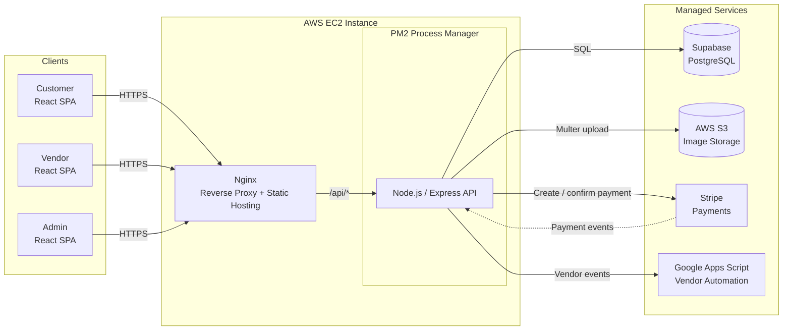
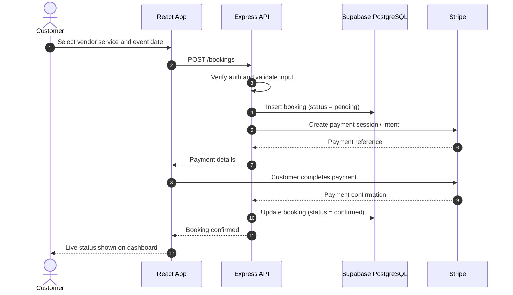
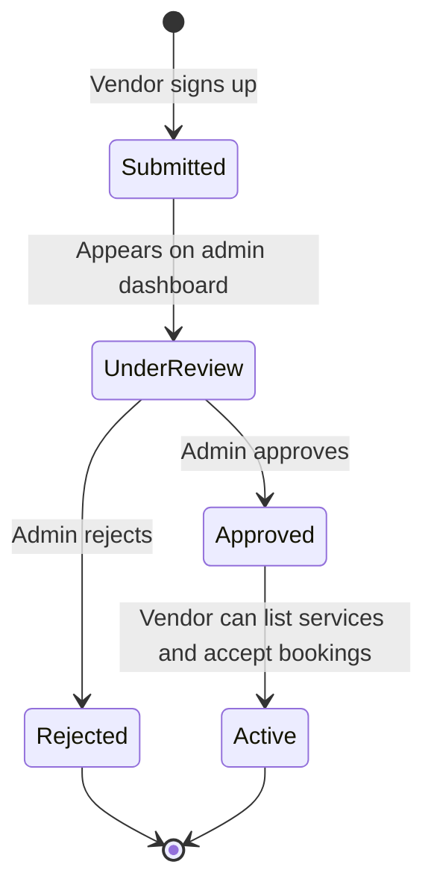
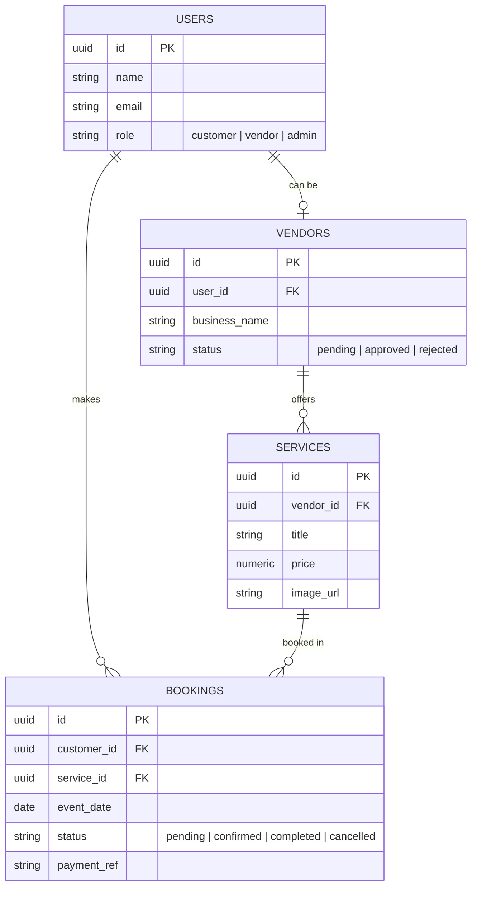
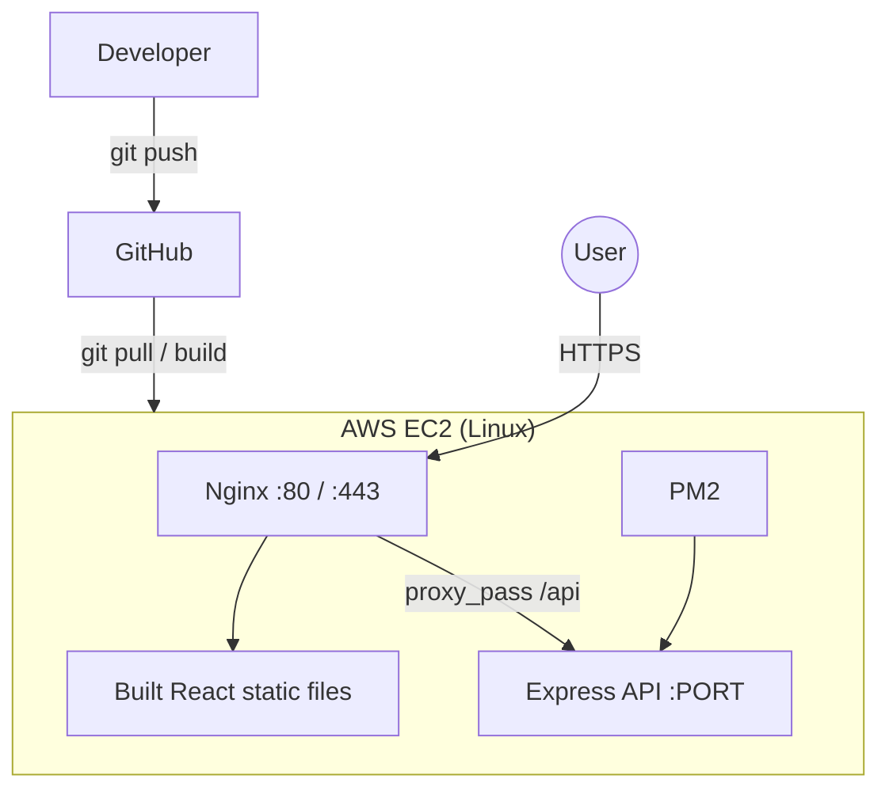

# 🎉 Celebration Marketplace

A two-sided event-booking marketplace where customers discover and book vendor services for their celebrations and pay securely through Stripe. Vendors are onboarded through an approval workflow, manage their own listings, and track bookings in real time.


<p>
  
  
  
  
  
  
  
</p>

---

## Table of Contents

- [Features](#features)
- [Tech Stack](#tech-stack)
- [System Architecture](#system-architecture)
- [Booking and Payment Flow](#booking-and-payment-flow)
- [Vendor Approval Workflow](#vendor-approval-workflow)
- [Data Model](#data-model)
- [Security](#security)
- [Deployment](#deployment)
- [API Overview](#api-overview)
- [Getting Started](#getting-started)
- [Environment Variables](#environment-variables)
- [Project Structure](#project-structure)
- [Design Decisions](#design-decisions)
- [Roadmap](#roadmap)
- [Author](#author)

---

## Features

**For customers**
- Browse vendors and services, and book for an event date
- Secure online payment through Stripe with payment confirmation
- Real-time booking status tracking (pending, confirmed, completed, cancelled)

**For vendors**
- Sign up and submit a profile for admin approval
- Create and manage service listings with image uploads
- View and respond to incoming bookings from a dashboard

**For admins**
- Live vendor approval dashboard to approve or reject applications
- Automated vendor workflows through Google Apps Script

**Platform**
- Role-based authorization middleware that scopes every route to the requesting user
- Image uploads handled with Multer and stored in AWS S3
- Production deployment on AWS EC2 behind Nginx, managed by PM2

---

## Tech Stack

| Layer | Technology |
| --- | --- |
| Frontend | React.js, JavaScript (ES6+) |
| Backend | Node.js, Express.js |
| Database | Supabase (PostgreSQL) |
| Payments | Stripe |
| File storage | AWS S3 (via Multer) |
| Automation | Google Apps Script |
| Infrastructure | AWS EC2, Nginx (reverse proxy), PM2 (process manager) |

---

## System Architecture



### Components

| Component | Responsibility |
| --- | --- |
| **React SPA** | Role-specific UIs for customers, vendors, and admins. Talks to the backend through REST APIs. |
| **Nginx** | Terminates HTTPS, serves the built frontend, and reverse-proxies `/api` requests to the Node.js process. |
| **Express API** | Business logic, request validation, authentication and authorization, and orchestration of all external services. |
| **PM2** | Keeps the API running, restarts it on crashes, and starts it on server reboot. |
| **Supabase PostgreSQL** | Source of truth for users, vendors, services, and bookings. |
| **AWS S3** | Stores vendor and service images. The database stores only the resulting URLs. |
| **Stripe** | Handles card payments so no sensitive card data touches this server. |
| **Google Apps Script** | Automates vendor workflows such as approval notifications and record syncing. |

### Request lifecycle

1. The browser sends an HTTPS request to Nginx.
2. Nginx serves static assets directly and proxies `/api/*` to the Express app.
3. Auth middleware verifies the caller's identity and role.
4. Ownership checks scope the query to the requesting user's own data.
5. The route handler reads or writes PostgreSQL and calls Stripe, S3, or Apps Script as needed.
6. A JSON response returns to the client, which updates the booking status in the UI.

---

## Booking and Payment Flow



Bookings are created as `pending` and only move to `confirmed` after Stripe confirms the payment, so a booking is never marked paid on the client's word alone.

---

## Vendor Approval Workflow



Only approved vendors can publish services and receive bookings. Status changes trigger Google Apps Script automations.

---

## Data Model

> Simplified overview. Adjust field names to match your actual schema.



---

## Security

- **Authorization middleware** on every protected route, scoped to the requesting user so customers and vendors can only access their own records
- **Role checks** separate customer, vendor, and admin capabilities
- **Stripe-hosted payments**, so card details never reach this server
- **Server-side confirmation** of payment before a booking is confirmed
- **Input validation** on API requests
- **Secrets in environment variables**, never committed to the repository
- **HTTPS** enforced at the Nginx layer
- **Scoped AWS IAM credentials** for S3 access

---

## Deployment



1. Build the React app (`npm run build`) and serve the output through Nginx.
2. Run the Express API with PM2 (`pm2 start server.js --name celebration-api`).
3. Save the process list and enable startup (`pm2 save && pm2 startup`).
4. Configure Nginx to proxy `/api` to the Node.js port.
5. Configure HTTPS, for example with Let's Encrypt and Certbot.

<details>
<summary>Example Nginx config</summary>

```nginx
server {
    listen 80;
    server_name your-domain.com;

    root /var/www/celebration-marketplace/build;
    index index.html;

    location / {
        try_files $uri /index.html;
    }

    location /api/ {
        proxy_pass http://127.0.0.1:5000;
        proxy_http_version 1.1;
        proxy_set_header Host $host;
        proxy_set_header X-Real-IP $remote_addr;
        proxy_set_header X-Forwarded-For $proxy_add_x_forwarded_for;
        proxy_set_header X-Forwarded-Proto $scheme;
    }
}
```

</details>

---

## API Overview

> Illustrative endpoints. Replace with your actual routes.

| Method | Endpoint | Description | Access |
| --- | --- | --- | --- |
| POST | `/api/auth/signup` | Register a new user | Public |
| POST | `/api/auth/login` | Log in | Public |
| GET | `/api/services` | List available services | Public |
| POST | `/api/services` | Create a service with image upload | Vendor (approved) |
| POST | `/api/bookings` | Create a booking and start payment | Customer |
| GET | `/api/bookings/me` | List the caller's bookings | Customer / Vendor |
| GET | `/api/admin/vendors` | List vendor applications | Admin |
| PATCH | `/api/admin/vendors/:id` | Approve or reject a vendor | Admin |

---

## Getting Started

### Prerequisites

- Node.js 18+
- A [Supabase](https://supabase.com) project
- A [Stripe](https://stripe.com) account (test mode is fine)
- An AWS account with an S3 bucket and an IAM user with access to it

### Installation

```bash
# 1. Clone the repository
git clone https://github.com/gauravv700/<your-repo-name>.git
cd <your-repo-name>

# 2. Install backend dependencies
cd server
npm install

# 3. Install frontend dependencies
cd ../client
npm install
```

### Run locally

```bash
# Terminal 1: backend
cd server
npm run dev

# Terminal 2: frontend
cd client
npm start
```

The frontend runs on `http://localhost:3000` and the API on `http://localhost:5000`.

---

## Environment Variables

Create a `.env` file in `server/` (and `client/` where needed). Never commit these files.

```env
# Server
PORT=5000
NODE_ENV=development

# Supabase
SUPABASE_URL=your_supabase_url
SUPABASE_KEY=your_supabase_service_key

# Stripe
STRIPE_SECRET_KEY=sk_test_xxx
STRIPE_WEBHOOK_SECRET=whsec_xxx

# AWS S3
AWS_ACCESS_KEY_ID=your_access_key
AWS_SECRET_ACCESS_KEY=your_secret_key
AWS_REGION=your_region
S3_BUCKET_NAME=your_bucket

# Auth
JWT_SECRET=your_jwt_secret

# Client
REACT_APP_API_URL=http://localhost:5000
REACT_APP_STRIPE_PUBLISHABLE_KEY=pk_test_xxx
```

---

## Project Structure

> Update to match your repository.

```
celebration-marketplace/
├── client/                 # React frontend
│   ├── src/
│   │   ├── components/
│   │   ├── pages/          # Customer, vendor, and admin views
│   │   └── services/       # API client
│   └── package.json
├── server/                 # Express backend
│   ├── routes/
│   ├── middleware/         # Auth and authorization
│   ├── controllers/
│   ├── config/             # Supabase, Stripe, S3 setup
│   └── server.js
├── docs/
│   └── screenshots/
└── README.md
```

---

## Design Decisions

- **Authorization scoped per user.** Every route filters by the requesting user rather than trusting IDs sent from the client, which prevents one user from reading or changing another's bookings.
- **Payment confirmed server-side.** Booking status changes to `confirmed` only after Stripe confirms payment, avoiding spoofed client-side success states.
- **Images in S3, URLs in the database.** Keeps the database small and fast, and offloads file serving.
- **Nginx in front of Node.** Handles TLS, static assets, and proxying efficiently, so Node only handles API logic.
- **PM2 for reliability.** Automatic restarts and startup on reboot keep the single-instance deployment resilient.
- **Apps Script for lightweight automation.** Avoids building and hosting a separate notification service for vendor workflows.

---

## Roadmap

- [ ] Reviews and ratings for vendors
- [ ] Search and filters by category, price, and date availability
- [ ] Vendor availability calendar to prevent double bookings
- [ ] Email and SMS notifications
- [ ] Automated tests (Jest) and CI pipeline
- [ ] Containerize with Docker

---

## Author

**Gaurav Kumar**
[LinkedIn](https://linkedin.com/in/gaurav700) · [GitHub](https://github.com/gauravv700) · [Portfolio](https://gaurav700.vercel.app)

---

If you found this project useful, consider giving it a ⭐
